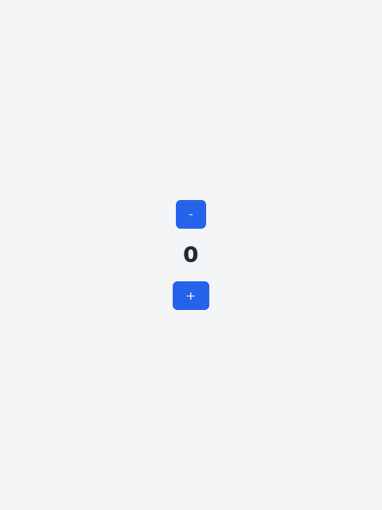
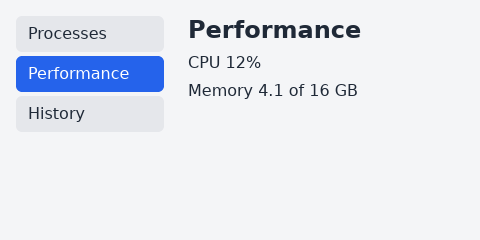
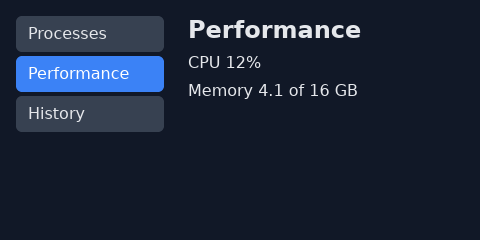
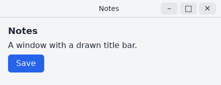
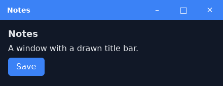
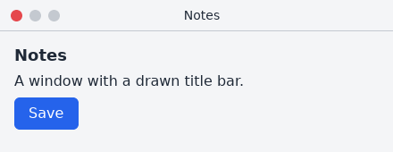

# pane

A window described as a function of your state. A Mote package, written in Mote over `std.gui` with no native code of its own.

| Step | Command or line |
|---|---|
| add it | nothing: it ships with Mote |
| use it | `import pane` |

You write a `view` that turns a state value into a tree of elements. Handlers on the elements change the state, and the window is drawn again from the new tree; only the nodes that differ are touched. It is built on `std.gui`, which stays available for anything the elements do not cover.

This page covers the app and its state, the elements and their modifiers, handlers, components, conditional rendering and paging, themes, keys, timers and shortcuts, state shared with other tasks, the title bar, running on a display, testing, and the modules.

## State and view

The state is a class. The view reads it and answers one element; handlers take the state as a `var` parameter and change it. `pane.App(title, state, view)` is the app, and `run` opens the window and keeps it up to date until it closes.

```mote,skip
import pane

class Counter {
    var count: Int
}

fn view(s: Counter) -> pane.Element<Counter> {
    return pane.vstack([
        pane.button("-").on_click(|var s| { s.count -= 1 }),
        pane.h1("${s.count}"),
        pane.button("+").on_click(|var s| { s.count += 1 }),
    ]).grow().center().gap(16.0)
}

fn main() {
    match pane.App("Counter", Counter { count: 0 }, view).run() {
        Err(e) => { println("cannot open the window: ${e.message}") }
        _ => { }
    }
}
```



| Modifier on the `vstack` | Effect in the window |
|---|---|
| `grow()` | the stack takes all the space the window leaves, so it fills it |
| `center()` | the children sit in the middle of the stack, across and down, buttons included |
| `gap(16.0)` | 16 px between the children |

Clicking `+` or `-` runs its handler, the view runs again, and the number changes.

## Elements

Every constructor answers an `Element<S>`, where `S` is the state class; the type is inferred from the view's return type.

| Constructor | Shows |
|---|---|
| `text(s)` | a line of 16 px text |
| `h1(s)` to `h6(s)` | bold text at 28, 24, 20, 18, 16 and 14 px |
| `rich(runs)` | text in several looks that wraps as one paragraph, from `gui.run(text)` runs: `pane.rich([gui.run("a "), gui.run("b").bold().link(1)])`; a link run with no color takes the theme's accent |
| `button(label)` | a button in the accent color that darkens under the pointer and darker still when pressed |
| `input(value, on_change)` | a one-line text field showing `value`; `on_change` is `\|var s, text\|` and stores what was typed |
| `input_multi(value, on_change)` | a text field of many lines, wrapped to its width; Enter breaks the line, Control with Enter runs `on_submit`, Control with `z` undoes. It is 76 px tall at least and grows with its text, or give it `height(px)` or `grow()` and it scrolls |
| `vstack(kids)` | children one under the other, 8 px apart |
| `hstack(kids)` | children side by side, 8 px apart, centered across |
| `box(kids)` | a plain box that lays its children out in a row |
| `scroll(kids)` | children one under the other that scroll when they do not fit; give it a `height` |
| `spacer()` | empty space that takes what the parent has left, to push siblings apart |

Modifiers answer a changed copy, so they chain: `pane.text("Done").bold().color(0x16a34aff)`.

| Modifier | Sets |
|---|---|
| `pad(px)`, `margin(px)`, `gap(px)` | space inside, outside, and between children |
| `width(px)`, `height(px)`, `grow()` | size; `grow` takes the free space left in the parent |
| `bg(color)`, `color(color)`, `radius(px)` | background, text color, corner radius; colors are `0xRRGGBBAA` |
| `border(px, color)` | a border |
| `hover_bg(color)` | the background under the pointer, for an element that is not a button |
| `size(px)`, `bold()` | font size and weight |
| `center()` | centers the children, buttons included, or the text of a button |
| `disabled()` | faded, and its handlers are dropped |
| `style(f)` | any `std.gui` style method: `el.style(\|s\| s.opacity(0.5))` |
| `key(id)` | names the element among its siblings, see Keys |
| `reveal(token)` | scrolls the `scroll` around the element so it sits at the top, when the view gives it a token other than 0 that it did not have before; use a counter in the state for the token (a table of contents that jumps to a heading) |

## Handlers

A handler is a lambda over the state. Its first parameter is the state and must be written `var`.

| Handler | Runs when | Lambda |
|---|---|---|
| `on_click(f)` | the element, or something inside it, is clicked | `\|var s\| { ... }` |
| `on_change(f)` | an input's text changed | `\|var s, text\| { ... }` |
| `on_submit(f)` | Enter was pressed in an input | `\|var s\| { ... }` |
| `on_link(f)` | a link run of a `rich` element is clicked; `id` is the number given to `link(id)` | `\|var s, id\| { ... }` |
| `on_drag(f)` | the pointer goes down on the element, moves while it is held, wherever it goes in the window, and comes up | `\|var s, d\| { ... }` |
| `on_wheel(f)` | the wheel turns over the element and nothing under the pointer scrolls; `dx` and `dy` are pixels | `\|var s, dx, dy\| { ... }` |

A `pane.Drag` has the `phase` (`pane.Phase.Start`, `Move` or `End`), the pointer at `x`, `y` and the press at `from_x`, `from_y`, and the element's box at the press as `left`, `top`, `width`, `height`. `dx()` and `dy()` are how far the pointer has moved since the press, and `across()` and `down()` how far along the element it is, from 0.0 to 1.0. The pointer must stay inside the window: a drag released outside it does not end until the next press.

`focus(token)` gives an element the keyboard focus when the view gives it a token other than 0 that differs from the one it had, as `reveal(token)` scrolls; keep a counter in the state and add one for each request.

After each handler the view runs again. An input shows the view's text, so its setter is required and stores what the user types or it will not stay:

```mote,skip
pane.input(s.name, |var s, t| { s.name = t })
```

`pane.space(n)` is `n` steps of 4 px and `pane.type_size(n)` a text size, 16 px at step 0 and times 1.25 for each step up: `pane.text("Note").size(pane.type_size(2)).pad(pane.space(2))`.

A click is handled by the nearest element under the pointer, or around it, that has an `on_click`. A handler that does the same work as another is a plain function over `var s`; both handlers call it.

## Components

Components larger than a control are modules you import by name. Each takes the current choice from the state and a handler that stores the next one.

| Import | Function | Shows |
|---|---|---|
| `import { nav } from pane.nav` | `nav(items, selected, on_pick)` | a column of buttons, the selected one highlighted, like a sidebar |
| `import { tabs } from pane.tabs` | `tabs(labels, selected, on_pick)` | a row of buttons, the selected one highlighted |
| `import { pages } from pane.pages` | `pages(count, current, on_pick)` | `<`, up to five page numbers around `current`, and `>` |
| `import { checkbox } from pane.checkbox` | `checkbox(label, checked, on_change)` | a box and a label that flip together |
| `import { select } from pane.select` | `select(id, options, selected, on_change)` | the choice, which opens in place to list the options |
| `import { image } from pane.image` | `image(png)` | a PNG scaled to the element's `width` and `height` |
| `import { slider } from pane.slider` | `slider(value, lo, hi, on_change)` | a rail filled up to `value`; pressing or dragging it runs `on_change(state, v)` with the value under the pointer |

`on_pick` is `|var s, i| { ... }` and gets the index picked, counting from 0. `checkbox`'s `on_change` gets the new `Bool`, and `select`'s gets the index chosen. Whether a `select` is open is the component's own state, kept by the app under `id`, so give each select its own:

```mote,skip
select("color", ["red", "green", "blue"], s.color, |var s, i| { s.color = i })
```

A component of your own that needs such state builds its element with `pane.with_locals(|l| ...)`: `l.get(id)` reads an `Int`, and an `on_local(|var l| { l.set(id, 1) })` click handler on a child writes it.

## Conditional rendering and paging

The view is a function, so what the window shows is an `if` in it. A sidebar with one item selected and the rest of the window following it:

```mote,skip
import std.gui as gui
import pane
import { nav } from pane.nav

class Monitor {
    var page: Int
}

fn page(s: Monitor) -> pane.Element<Monitor> {
    if s.page == 1 {
        return pane.vstack([pane.h2("Performance"), pane.text("CPU 12%"), pane.text("Memory 4.1 of 16 GB")])
    }
    if s.page == 2 {
        return pane.vstack([pane.h2("History"), pane.text("Nothing recorded yet")])
    }
    return pane.vstack([pane.h2("Processes"), pane.text("mote 1.2%"), pane.text("zed 3.4%")])
}

fn view(s: Monitor) -> pane.Element<Monitor> {
    return pane.hstack([
        nav(["Processes", "Performance", "History"], s.page, |var s, i| { s.page = i })
            .style(|st| st.width(gui.Size.Pct(33.0))),
        page(s),
    ]).grow().style(|st| st.align_items(gui.Align.Start).gap(24.0))
}
```



Only one item is selected because the state holds one number. `width(gui.Size.Pct(33.0))` makes the sidebar a third of the window. A page that was not chosen is not in the tree, so its nodes are removed.

Paging a list is the same: the state holds the page, the view shows that slice of the data, and `pages` changes the page.

```mote,skip
import { pages } from pane.pages

fn view(s: Inbox) -> pane.Element<Inbox> {
    var rows: List<pane.Element<Inbox>> = []
    var i = s.page * 10
    while i < s.subjects.len() && i < s.page * 10 + 10 {
        rows.push(pane.text(s.subjects.get(i)))
        i = i + 1
    }
    return pane.vstack([
        pane.vstack(rows),
        pages((s.subjects.len() + 9) / 10, s.page, |var s, p| { s.page = p }),
    ])
}
```

## Theme

Every element takes its colors from the window's theme, set once when the window opens. A theme is a value from `pane.theme`: the presets are `light()` (the default), `dark()` and `contrast()`. `App.theme(t)` sets it.

```mote,skip
import pane
import pane.theme

match pane.App("Monitor", Monitor { page: 0 }, view).theme(theme.dark()).run() {
    Err(e) => { println(e.message) }
    _ => { }
}
```



A preset changes through methods that answer a changed copy: `theme.dark().accent(0xf97316ff).radius(10.0)`.

| Method | Sets |
|---|---|
| `ink(c)`, `accent_ink(c)` | the text color, and the text color on the accent |
| `page(c)`, `surface(c)`, `quiet(c)` | the window background, the fill of inputs and checkboxes, the fill of choices that are not selected |
| `accent(c)`, `border(c)` | the color of buttons and of the selected choice, the border of inputs and checkboxes |
| `radius(px)` | the corner radius of buttons, inputs and choices |
| `shading(hover, press)` | the percent a pressable color is scaled by under the pointer and when pressed; under 100 darkens |
| `text_size(px)` | the size of ordinary text, 16 by default; buttons, inputs and the title bar follow it |
| `spacing(px)` | the unit the padding of buttons, inputs, choices and the window is counted in, 4 by default |

A `theme.Tone` names one of a theme's colors (`Ink`, `Page`, `Surface`, `Quiet`, `Border`, `Accent`, `AccentInk`) or a fixed one (`Rgba(c)`); `th.color(tone)` answers the color. The title bar is painted in tones, so it follows the theme. Fonts are the system's; there is no choice of typeface.

`app.theme_by(f)` and `app.chrome_by(f)` take the theme and the frame from a function of the state, read at every draw, for an app that lets the user change them: `app.theme_by(|s| prefs_theme(s))`. The window follows at once, and a change of frame turns the system's off or on.

`bg`, `color` and `style` on an element still win over the theme for that element. Components that are not controls, such as the `markdown.view` package's code blocks, rules and table cells, take their look from theme roles (`Role.Code`, `Role.Rule`, `Role.Cell`), so a theme restyles them.

## Keys

Siblings are matched with the last drawn tree by position and kind. When a list reorders or has items removed from the front, that match moves the wrong node: an input that held focus ends up showing its neighbour. A key says which element is which:

```mote,skip
for n in s.names {
    rows.push(pane.input(n.text).key(n.id).on_change(|var s, t| { s.rename(n.id, t) }))
}
```

An element with a key keeps its node, focus and scroll when it moves among its siblings. An element without a key is matched by position. A key must be unique among its siblings and only names the element in its own list.

## Timers and shortcuts

| Method | Runs |
|---|---|
| `every(ms, f)` | `f` as a handler every `ms` milliseconds while the window is open; the view runs after it |
| `watch(ms, f)` | `f` every `ms` milliseconds; it answers `true` when it changed the state, and the view runs only then |
| `on_key(key, mods, f)` | `f` as a handler when `key` is pressed with exactly those modifiers |

```mote,skip
pane.App("Clock", Clock { seconds: 0 }, view)
    .every(1000, |var c| { c.seconds += 1 })
    .on_key(gui.Key.Escape, gui.no_mods(), |var c| { c.seconds = 0 })
    .run()
```

A timer posts its next tick only after the last one was handled, so a slow view never queues ticks in front of a close. Use `watch` for polling something that rarely changes, such as a file, so an unchanged tick costs no redraw.

## State shared with other tasks

By default the state lives in the window's task. `app.state()` moves it into a shared cell and answers a `Handle`: `handle.get()` reads a copy and `handle.update(|var s| { ... })` changes it from any task, and the window draws again by itself. Call `state()` before `run`.

```mote,skip
import std.task as task
import std.time as time
import pane

class Jobs {
    var done: Int
}

fn view(j: Jobs) -> pane.Element<Jobs> {
    return pane.vstack([pane.h2("Jobs done: ${j.done}")])
}

fn main() {
    var app = pane.App("Jobs", Jobs { done: 0 }, view)
    let jobs = app.state()
    scope {
        spawn {
            for i in 0..10 {
                jobs.update(|var j| { j.done += 1 })
                time.sleep(time.Duration.from_secs(1))
            }
        }
        app.run().unwrap()
    }
}
```

Every `update` copies the state, so a handler that runs often on a large state is cheaper without a `Handle`.

## Title bar

By default the system draws the window's frame. `App.chrome(c)` turns the system frame off and draws a title bar in the theme's colors, with minimize, maximize and close buttons and a strip along each edge and corner that resizes the window. The app's title is what the bar shows.

```mote,skip
import pane
import pane.theme
import pane.chrome

match pane.App("Counter", Counter { count: 0 }, view).theme(theme.dark()).chrome(chrome.banner()).size(420, 200).run() {
    Err(e) => { println(e.message) }
    _ => { }
}
```

| Preset | Bar |
|---|---|
| `chrome.system()` | the system's own frame; the default |
| `chrome.slate()` | a low bar the color of the page under a thin line, the title in the middle, small rounded keys at the right, a coral close |
| `chrome.banner()` | a tall bar in the accent color, a bold title at the left, square keys at the right, close darkening under the pointer |





Both are starting points for a bar of your own: every method answers a changed copy, as with a theme.

| Method | Sets |
|---|---|
| `height(px)` | the height of the bar |
| `buttons(shape)` | `chrome.Buttons.Block` (full-height squares), `Small` (rounded keys) or `Dots` (round dots) |
| `buttons_left(on)` | the buttons at the left, close first, instead of at the right |
| `title_align(a)` | the title at the `Left`, `Center` or `Right` (`gui.TextAlign`) |
| `bar_color(tone)`, `key_color(tone)` | the bar's color, which the minimize and maximize keys share unless `key_color` follows it, and the keys' own color; they are shaded under the pointer |
| `title_color(tone)` | the title and the keys' symbols |
| `close_color(tone)`, `dot_color(tone)` | what the close button turns under the pointer, and the minimize and maximize dots (the close dot takes the close color) |
| `rule(on)` | a thin line in the border color under the bar |

```mote,skip
let bar = chrome.slate().buttons(chrome.Buttons.Dots).buttons_left(true).bar_color(theme.Tone.Quiet)
```



Dragging the bar moves the window; the buttons act when clicked. Under the hood the bar is elements with an `action(...)`, which a program can give to its own elements: `Move` drags the window, `Resize(edge)` resizes from an edge, and `Minimize`, `Maximize` and `Close` act on a click.

## Running on a display

`App.run()` pins the calling task, opens the window, and returns when it closes. The size defaults to 480 by 640 pixels; `size(w, h)` changes it:

```mote,skip
pane.App("Counter", Counter { count: 0 }, view).size(320, 240).run()
```

`maximized()` opens the window filling the screen's work area with its frame kept; `fullscreen()` covers the whole screen with no system frame, so pair it with `chrome(...)` for a title bar pane draws, which has its own close button (without one, the system's shortcut such as Alt+F4 closes it). Neither does anything in a headless app. A window you open yourself takes `win.set_maximized(on)` and `win.set_fullscreen(on)`.

Without a display `run` is an `Err`, as in `std.gui`. `demo.mote` beside this file is a larger program: a counter and a to-do form with a scrolling list.

For a window you open yourself, `app.mount(win)` draws the view once and answers a `Running` app; `running.step(event)` handles one window event and redraws, and `running.run()` steps until the window closes. `App.run` is `gui.open` followed by those.

## Testing

`app.headless(width, height)` draws on a window with no screen, and the answer drives it the way a person would:

| Method | Does |
|---|---|
| `find(text)`, `shows(text)` | the node showing exactly `text`, and whether there is one |
| `click_text(text)` | clicks the middle of that node and runs the handlers |
| `type_into(current, text)` | focuses the input showing `current` and types `text` |
| `press(key, mods)` | presses and releases a key |
| `click_at(x, y)` | clicks a point of the window |
| `drag(x0, y0, x1, y1)` | presses at the first point, moves to the second and releases there; both must be inside the window |
| `wheel(x, y, dx, dy)` | turns the wheel with the pointer at a point |
| `window()` | the `gui.Window`, for `png`, `pixel` and `rect` |

```mote,skip
var app = pane.App("Counter", Counter { count: 0 }, view).headless(300, 200).unwrap()
app.click_text("+").unwrap()
println(app.shows("1"))
```

A headless app reads its own events; to read them yourself, make the window with `gui.headless` and use `mount`.

## Modules

`import pane` brings in the core. Each part of it is also a file you can import by name, and the larger components are files you import only when you use them.

| Import | Holds |
|---|---|
| `import pane` | the core: `Element`, the controls and layouts, `Theme`, `App`, `Running`, `Handle`; used as `pane.vstack`, `pane.button` and so on |
| `import pane.element` | `Element` and its modifiers |
| `import pane.controls` | `text`, `h1` to `h6`, `button`, `input` |
| `import pane.layout` | `vstack`, `hstack`, `box`, `scroll`, `spacer` |
| `import pane.theme` | `Theme`, `Tone`, the presets `light`, `dark`, `contrast`, and `space`, `type_size` |
| `import pane.chrome` | `Chrome`, `Buttons` and the presets `system`, `slate`, `banner` |
| `import pane.app` | `App`, `Running` and `Handle` |
| `import pane.nav`, `tabs`, `pages`, `checkbox`, `select`, `slider`, `image` | one component each, see Components |

A name imported through both `import pane` and one of these files is the same function, so the two imports can sit together.

## How a redraw works

| Rule | Because |
|---|---|
| the view runs after every handler, and after a `win.post` event | the window always shows the state |
| a keyed child is matched by its key, an unkeyed one by position and kind | a node keeps its place, focus and scroll when its siblings move |
| a child that no longer matches is rebuilt in its place | a changed kind loses only its own focus and scroll |
| an input is rewritten only when the view's text for it changed | typing the state has not yet heard of is not overwritten |
| pointer movement, hovering, an unused wheel turn, a click or key nobody handles, and a `watch` that answers `false` do not run the view | a large view takes long to sync, and these events come in floods |
| a `memo` element whose token is the same as at the last draw is not built and its nodes are not touched | a large view that changes a little costs what changed |

### Large views

A view of thousands of nodes costs time on every redraw, because each node is compared and restyled. `pane.memo(token, || element)` builds an element only when `token` (not 0) differs from the one it had at the last draw; while the token is the same, `build` does not run and the window keeps what it drew. Give each memo element a `key` when siblings can come and go, so it is matched by key.

```mote,skip
var i = 0
while i < lines.len() {
    let line = lines.get(i)
    kids.push(pane.memo(versions.get(i), || { return pane.text(line) }).key("line${versions.get(i)}"))
    i = i + 1
}
```

The token must change whenever the element would look or act differently, including what it reads from `Locals`; pane does not look inside a memo element to find out. A `reveal` on an element inside a memo element is not seen again until the token changes.

## Behaviour

| Item | Value |
|---|---|
| state | one class value, changed in place by handlers, or a shared cell behind `app.state()` |
| tree comparison | by key, else by position and kind |
| theme | `light`, `dark` or `contrast`, changed through methods; set once per window |
| title bar | the system's, or one pane draws; a window with the bar drawn by pane shows no resize cursor at its edges and does not maximize on a double click yet |
| not yet | focus order beyond `focus(token)`, tables, menus, dialogs and a clipboard |

## Tests

`mote test` in this directory runs `tests/`, which drive headless windows and need no display.
